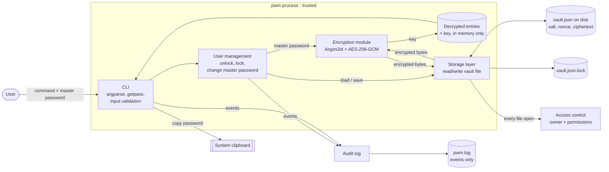

# Design document

Password manager, ICS0022 Secure Programming. Written for Checkpoint 1 and updated for
Checkpoint 3 (new parts: validation, access control, audit log, secure memory, threats A1-A4,
L1-L4 and M6).

## 1. Architecture

The program has four main parts:

- CLI: parses commands, reads the master password with `getpass` (not echoed) and prints results.
  All user input goes through here and gets validated before it reaches the other modules.
- User management: handles unlocking the vault, changing the master password and locking
  the vault again when the command finishes. It never stores the master password. A password is
  correct when the vault decrypts successfully.
- Encryption module: derives the key from the master password with Argon2id, and encrypts or
  decrypts the vault with AES-256-GCM. This is the only module that uses the crypto libraries.
- Storage layer: reads and writes the vault file. It does not know anything about the
  contents; it only handles bytes, file permissions and safe writing.

Since Checkpoint 3 there are four smaller helper modules that the main parts use:

- Validation (`validate.py`): all input rules in one place. The CLI and the vault both use
  it, and the vault also checks the records it decrypts.
- Access control (`access.py`): checks that every file belongs to the current user and that
  nobody else can access it (file modes on Linux, ACLs on Windows).
- Audit log (`audit.py`): writes key events to `pwm.log` as JSON lines, without secrets.
- Secure memory (`secmem.py`): keeps the key in a locked buffer and wipes secrets after use.



### Data flow

Unlocking (for example `pwm get github`):
1. The CLI asks for the master password at a hidden prompt.
2. User management asks the storage layer for the vault file.
3. The storage layer reads `vault.json` and returns it.
4. The encryption module takes the salt and the KDF settings from the file, derives the key with
   Argon2id and decrypts the ciphertext with AES-GCM.
5. If decryption fails, the password is wrong or the file was changed. The user gets the same
   error message in both cases.
6. If it works, the entries are kept in memory, the command runs, and the result is printed.

Saving (after `add`, `update`, `delete`):
1. The entries are turned into JSON and encrypted with the same key and a new random nonce.
2. The storage layer writes the result to a temporary file in the same folder with permissions
   0600, and then replaces the old vault with it. A crash in the middle cannot leave a
   half-written vault.

### Where data lives

| Data | Where | Protected by |
|---|---|---|
| Vault (all entries) | `~/.pwmanager/vault.json` | AES-256-GCM, owner only (0600 or private ACL) |
| Salt, nonce, KDF settings | inside `vault.json`, not encrypted | not secret, but covered by the GCM tag so changes are detected |
| Encryption key | process memory only, in a `SecretBytes` | locked in RAM, overwritten with zeros when the vault is locked |
| Master password | process memory only, only during unlock | never stored anywhere, wiped after unlock |
| Decrypted entries | process memory only | the vault's own copies are wiped when the command ends |
| Copied password | system clipboard | cleared after 20 seconds |
| Lock file | `vault.json.lock` | empty, owner only |
| Audit log | `pwm.log` next to the vault | events only, no secrets, owner only |

### Trust boundaries

1. User / terminal to CLI: everything typed in is untrusted (command names, entry names,
   lengths). The CLI validates it before passing it on.
2. Disk to storage layer: the vault file can be read, copied, changed, or replaced (for
   example by a symlink) by someone else. It is not trusted until the GCM tag has been verified.
3. Clipboard: other programs can read it, so a password only stays there for a short time.

Everything inside the `pwm` process is treated as trusted. Attacks on the machine itself, like
malware running as the same user or a keylogger, are out of scope. There is more on this in the
threat model.

## 2. Threat model

I followed the steps from the Week 2 lecture: identify the assets, describe the architecture,
break the app into parts, then identify, document and rate the threats. The architecture and the
parts are in section 1, so this section starts with the assets.

### Assets

- the master password
- the stored credentials (usernames, passwords, notes)
- the encryption key derived from the master password
- the vault file itself (it has to stay intact and usable)

### Attackers I considered

- Someone who gets a copy of `vault.json` (stolen laptop, backup, cloud sync folder)
- Another user on the same machine
- Someone looking at the screen
- The user making mistakes (typing something wrong, the program crashing while saving)

Out of scope: malware running as the same user, keyloggers, and someone with root or admin
access. If the machine is compromised like that, a local password manager can't protect the
vault.

### Rating

Each threat is rated High, Medium or Low, based on how likely it is and how bad the result
would be.

### 2.1 Master password

| ID | Threat | Rating | Mitigation |
|---|---|---|---|
| M1 | Attacker with a copy of the vault guesses the master password offline (brute force or wordlist) | High | Key is derived with Argon2id (64 MiB memory, 3 iterations), so every guess is slow. A random 16-byte salt per vault stops precomputed tables. `init` requires at least 12 characters. |
| M2 | Master password is visible while typing | Low | Read with `getpass`, so it is not echoed. |
| M3 | Master password ends up in shell history or the process list | Medium | There is no option to pass it as an argument. It is only read from the prompt. |
| M4 | Master password or key leaks through an error message or traceback | Medium | Exceptions are caught at the top of the program and only a short generic message is printed. Nothing secret is logged (see L1, L2). |
| M5 | Error messages tell an attacker whether the password was wrong or the file was changed | Low | The same message is printed for both: "could not unlock vault". |
| M6 | Someone at the keyboard tries many master passwords | Low | After a wrong password the program waits 2 seconds before it answers, and the failure is logged. Offline guessing is slowed down by Argon2id (M1), not by this. |

### 2.2 Vault at rest

| ID | Threat | Rating | Mitigation |
|---|---|---|---|
| V1 | Someone reads the vault file | High | All entries are encrypted with AES-256-GCM. Only the salt, nonce and KDF settings are stored in plain text, and they are not secret. |
| V2 | Someone modifies the vault file (ciphertext or header) | High | GCM authenticates the ciphertext. The header (version, salt, KDF settings) is passed as associated data, so changing it also makes decryption fail. |
| V3 | Attacker lowers the KDF settings in the header to make guessing faster | Medium | The program refuses to open a vault with settings below the minimum values it uses itself. |
| V4 | The same nonce is used twice with the same key, which breaks GCM | High | A new random 12-byte nonce is made with `os.urandom` on every save. |
| V5 | Another user on the machine reads the file | Medium | The vault folder is created with mode 0700 and the file with 0600. On Windows the file gets a private ACL. See A1-A2. |
| V6 | The program crashes while saving and leaves a broken vault | Medium | It writes to a temporary file in the same folder, calls `fsync`, and then uses `os.replace`, which is atomic. The old vault stays until the new one is complete. |
| V7 | Symlink attack: the vault or temp file path is replaced with a link to another file (Week 3) | Medium | The temp file is created with `tempfile.mkstemp` (uses `O_CREAT \| O_EXCL`). Before opening, the vault path is checked with `os.lstat` and rejected if it is a symlink. On Linux it is opened with `O_NOFOLLOW`. |
| V8 | An older copy of the vault is put back (rollback) | Low | Not fully prevented. The old copy still needs the master password, so the attacker only gets old data back. I accept this risk for this project. |

### 2.3 Vault in memory

| ID | Threat | Rating | Mitigation |
|---|---|---|---|
| R1 | Key and decrypted entries stay in memory longer than needed | Medium | Each command unlocks, does its job and exits, so secrets only live for the length of one command. The key is in a `SecretBytes` buffer that is locked in RAM (`VirtualLock`/`mlock`, so it is not swapped to disk) and overwritten with zeros on lock. Argon2id writes the key straight into that buffer. The decrypted bytes, the JSON text, the typed passwords and the vault's copies of all fields are overwritten in place with ctypes. What is left: non-ASCII strings, short-lived copies inside the libraries and the JSON encoder, and OpenSSL's own copy of the key. |
| R2 | Secrets are written to disk in a crash dump | Low | On Linux, core dumps are disabled at startup with `resource.setrlimit(RLIMIT_CORE, 0)`. |
| R3 | Secrets appear in a traceback on screen | Medium | Same as M4: exceptions are handled at the top level and tracebacks are not shown to the user. |

### 2.4 Interface (CLI)

| ID | Threat | Rating | Mitigation |
|---|---|---|---|
| I1 | Bad or very long input (entry names, field values, numbers) causes errors or unexpected behaviour | Medium | Input is validated with an allow-list (Week 4). Entry names must match `[A-Za-z0-9._@-]{1,64}`. `--length` must be a number between 8 and 128 written with ASCII digits. Text fields have a maximum length and can't contain control characters or invisible Unicode characters (for example U+202E, which reverses text). Usernames and notes are normalised to NFC. Passwords are not, so they stay exactly as typed. The same checks run in the CLI, in the vault, and on the records read from a decrypted vault. |
| I2 | Path traversal through a custom vault path (`../`) | Medium | The vault path is turned into an absolute path with `os.path.realpath` and must end in `.json`. It is only opened after this check. |
| I3 | Password shown on screen | Low | The program never prints a password. `get` shows it as `********` and `--copy` puts it on the clipboard instead. (The `--show` option from the first plan was dropped for Checkpoint 2.) |
| I4 | Password stays in the clipboard and other programs read it | Medium | The clipboard is cleared after 20 seconds, but only if it still holds the copied password. |
| I5 | Generated passwords are predictable | High | They are made with the `secrets` module, not `random`. |
| I6 | An entry or the vault is deleted by mistake | Low | `delete` asks for confirmation. `init` refuses to overwrite an existing vault. |

### 2.5 Access control (added in Checkpoint 3)

The vault is for one person, so the "user" here is the operating system account. Each OS user
has their own vault, and the program makes sure one user can't use or read another user's files.

| ID | Threat | Rating | Mitigation |
|---|---|---|---|
| A1 | Another user places or replaces a vault, lock or log file that pwm then uses | Medium | Every file is checked when it is opened: the owner must be the current user (uid on Linux, SID on Windows). If not, pwm refuses with "belongs to another user". On Linux the check uses the open file descriptor, so it checks the file that was really opened. |
| A2 | Our own files can be read by other users (wrong mode, or the inherited ACL on Windows) | Medium | New files are made private before anything is written to them: 0600 on Linux, an ACL with only the current user on Windows. An existing file with too open permissions is fixed and the fix is logged. A folder the user picked is not changed, only `~/.pwmanager` and folders pwm creates. |
| A3 | A record operation runs on a locked vault, or by a different user than the one who unlocked it | Low | Every record operation (list, read, add, update, delete, save, change master) starts with `_authorize()`, which refuses in both cases. |
| A4 | Two pwm commands change the vault at the same time and one change is lost | Low | The vault is locked with `flock` / `msvcrt.locking` on `vault.json.lock` from unlock until the command ends. A second command gets "the vault is being used by another pwm command". |

### 2.6 Logging and error handling (added in Checkpoint 3)

| ID | Threat | Rating | Mitigation |
|---|---|---|---|
| L1 | A secret ends up in the log file | High | The log only accepts known event names and known fields, and every value must match a strict pattern. There is no field for free text, so passwords, usernames, notes and error messages can't be logged. Entry names are not logged because the vault hides them on purpose. Tests run every command and check that no secret is in any file. |
| L2 | An error message shows internal details (paths inside the program, library messages, tracebacks) | Medium | Only errors the program raises on purpose (`PwmError`) show their message. Everything else prints "unexpected error" and is logged with the exception class name only. |
| L3 | Someone forges log lines with input that contains a newline | Low | Every event is one `json.dumps` line with `ensure_ascii`, and values that don't match their pattern are replaced with "invalid". |
| L4 | Other users read the log | Low | The log file gets the same checks as the vault (A1, A2). |

## 3. Design decisions

### Language and libraries

I chose Python because it lets me spend the time on the security parts instead of memory
management. Most of the memory bugs from the lectures (buffer overflows, off-by-one errors,
missing null terminators) can't happen in normal Python code. The downside is that I have less
control over memory, so secrets can't be fully wiped (see R1).

- `cryptography`: well maintained and uses OpenSSL underneath. I use its `AESGCM` class. I don't
  use `Fernet`, because it is AES-128-CBC + HMAC and doesn't support associated data, which I
  need for the header (V2).
- `argon2-cffi`: Argon2id is memory-hard, so guessing with GPUs is much more expensive than with
  PBKDF2. I call the low-level C function `argon2_hash` directly, so the 32-byte key is written
  straight into a locked buffer (see R1).
- `secrets` and `os.urandom` for all random values (salt, nonce, generated passwords).
- I don't write any crypto myself.

### Crypto scheme

1. On `init`, a random 16-byte salt is generated.
2. key = Argon2id(master password, salt, time_cost=3, memory_cost=64 MiB, parallelism=4,
   output 32 bytes)
3. On every save, a new random 12-byte nonce is generated.
4. ciphertext = AES-256-GCM(key, nonce, plaintext = entries as JSON, associated data = header)
5. On load, the same key is derived from the salt in the file. If decryption or the tag check
   fails, the vault is not opened.

Changing the master password makes a new salt and a new key and re-encrypts everything.

### Vault format

The vault is one JSON file. The header is readable but authenticated. Everything else is inside
the ciphertext, so an attacker can't even see the entry names or how many entries there are.

```json
{
  "header": {
    "format": "pwm-vault",
    "version": 1,
    "kdf": "argon2id",
    "kdf_params": { "time_cost": 3, "memory_cost": 65536, "parallelism": 4 },
    "salt": "<base64, 16 bytes>",
    "cipher": "aes-256-gcm",
    "nonce": "<base64, 12 bytes>"
  },
  "ciphertext": "<base64, encrypted entries + 16-byte GCM tag>"
}
```

The header is turned into bytes with `json.dumps(header, sort_keys=True, separators=(",", ":"))`
and used as the associated data. This way the bytes are always the same when the file is read
back.

After decryption, the plaintext looks like this:

```json
{
  "entries": {
    "github": {
      "username": "javid",
      "password": "...",
      "notes": "",
      "created": "2026-09-25T18:00:00Z",
      "modified": "2026-09-25T18:00:00Z"
    }
  }
}
```

The `version` field is there so the format can change later without breaking old vaults.

I also considered SQLite with encrypted fields. I didn't choose it because entry names and the
number of entries would be visible, and it adds more code. Encrypting the whole file is simpler
and hides more. The downside is that the whole vault is rewritten on every save, which is fine
for a personal vault with a few hundred entries.
